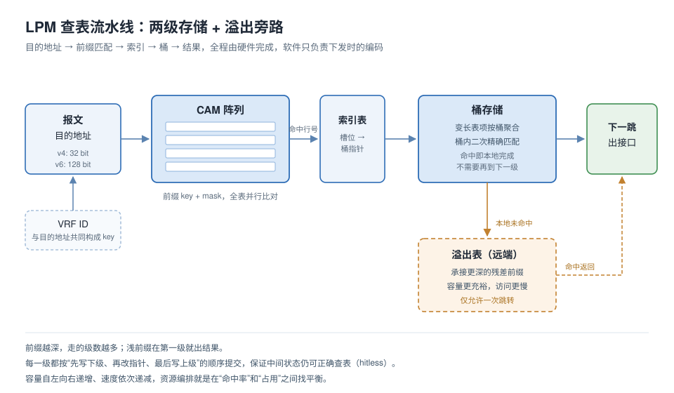

# LPM 表项管理（TCAM + SRAM）

TCAM 存 key 和 mask，SRAM 按行号存 payload。IPv6 /128 的 key 加 mask 共 256 bit，超过单行位宽，一条表项要跨几行。

跨行之后有三件事要一起处理：拆几行、续行怎么跟首行绑、删掉之后留下的洞怎么补。分配算得不好，实际能装的路由数会远低于标称容量。

`python tests/test_sweep.py` 跑地址扫描。不依赖厂商 SDK，只用标准库，Python 3.9 以上能跑。



## 表结构

路由统一成 `(key, key_len, payload)`。IPv4 左移 96 位对齐到 128 位空间，和 IPv6 共用一张表：

```
IPv4 10.1.2.0/24    key = 0x0a010200 << 96   key_len = 24
IPv6 2001:db8::/64  key = 2001:0db8::0000    key_len = 64
```

远端模式只改 payload，key 不动，匹配语义不变。

一条表项占多少行：

```
rows = ceil(round_up(key_len, 8) / cell_bits) + ceil(payload_bits / cell_bits)
```

`key_len` 按 8 bit 向上取整，否则短前缀的 mask 在行内表达不出来。

## 多行拼接

一条表项占多行时，只有首行 `VLD=1`，其余行 `VLD=0`，靠首行的 `span` 字段带出来。匹配器只在 `VLD=1` 的行里挑最长前缀，命中后按 `span` 检查后续行是否完整。

只对上后半段的行不会被当成命中。优先级按表项比，跟行数无关。

## cell 位宽

6000 条混合前缀（60% IPv4 /8~/24，40% IPv6 /32~/128），固定行预算，40% 插删，三档实测：

| cell 位宽 | 平均 span | 位利用率 | 能装下条目 | 碎片挡住 |
|---|---|---|---|---|
| 32 bit | 2.71 | 0.851 | 2117 | 1490 |
| 48 bit | 2.44 | 0.625 | 2353 | 1429 |
| 64 bit | 2.22 | 0.515 | 2551 | 1394 |

窄位宽位利用率高，span 大，要求的连续空间长，碎片一多就插不进去。宽位宽能塞更多条目，代价是填充位多：IPv4 /8 放进 64 bit 行只占 8 位，剩下 56 位空着。

选哪个看硬件先耗尽行数，还是先耗尽总位数。

## 删除与压缩

表项长度不等，删除留洞。洞尺寸不规整，长表项插不进去。

删除只置标记位，碎片率超阈值再整段压缩。阈值取 0.25：低于这个值，零星空洞还能被短表项吃掉；高于它，连续大块基本不会自然形成，会出现空闲总量够、却插不进一条 /128 的情况。

分配用 best-fit，在空闲区里找尺寸最接近的洞。

## 验证

错误集中在前缀长度 0/1/31/32/127/128、相邻前缀重叠、本地溢出到远端的那一条、压缩中间态。常规流量不落在这些位置上。

按前缀长度分层做地址扫描，不用典型用例。每层四个探测点：网络地址、加一、减一、掩码外翻转一位。

期望值取自另一份独立的朴素最长匹配：遍历全部前缀取最长。O(n)，慢，但不带被测实现的假设。两边对不上就是模型错了。

失败输出带前缀长度、探测类型、地址、期望与实际、锚行行号和 span。

```
python tests/test_sweep.py
python tests/test_sweep.py --len 127
```

## 目录

```
src/lpm_table.py        表模型：insert / lookup / delete
src/cell_allocator.py   best-fit 分配，位宽对比
src/prefix_gen.py       前缀与探测点生成
tests/test_sweep.py     地址扫描测试
docs/architecture.md    分配策略与拼接细节
docs/test-method.md     验证方法
```

## 范围

行为级模型，没有时序。容量参数是抽象值，不对应具体芯片。芯片规格、寄存器映射、编码格式属于受限信息，没有公开。

MIT
