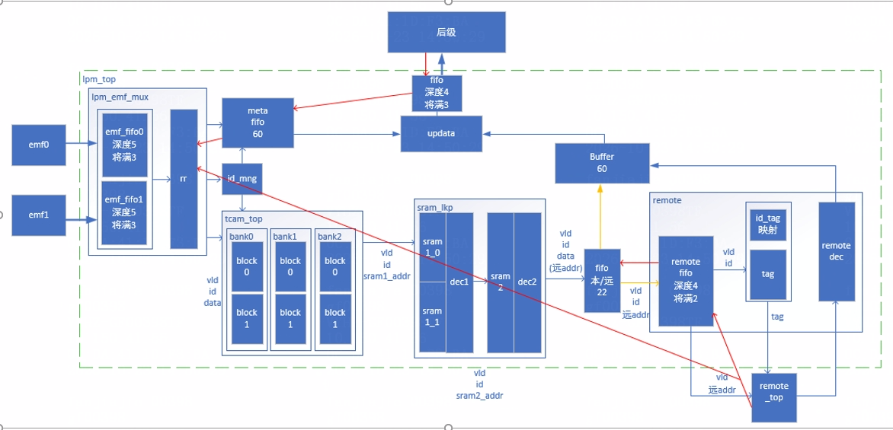
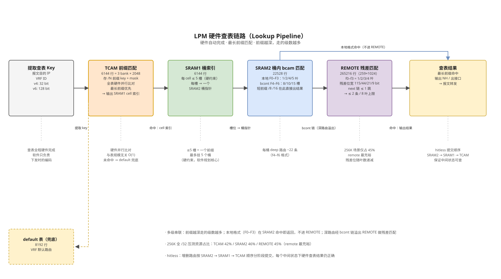

## 1. 项目定位

交换芯片 LPM（Longest Prefix Match，最长前缀匹配）模块的 SDK 实现，负责 IPv4/IPv6 FIB 表项在芯片硬件表中的下发编码。

- 软件：路由表项 add / delete / update / read，把软件侧路由编码成硬件表格式写入；
- 硬件：报文转发时查表（lookup），按最长前缀命中并返回下一跳；
- 难点：FIB 规模十万级，硬件表资源有限（TCAM 6K / SRAM 28K / REMOTE 259K），且增删路由不能打断转发（hitless）。

两种下发模式和两种资源模式：

| 维度 | 取值 | 说明 |
|------|------|------|
| 算法模式 | `LPM_STATIC` | 整表一次性编码下发，适合路由表相对固定的场景 |
| | `LPM_DYNAMIC` | 逐条 add/delete/update，运行时动态增删 |
| 资源模式 | LOCAL | 不用 REMOTE，仅 TCAM + SRAM1 + SRAM2 |
| | REMOTE | 深路由溢出（spill）到 REMOTE 远端表 |

## 2. 硬件逻辑

lpm_top 整体框图：



### 2.1 五张硬件表

| 表 | 容量 | 条目宽度 | 作用 |
|----|------|---------|------|
| TCAM | 6144 行（3 bank × 2048） | key 10B(v4) / 20B(v6) + mask | 前缀匹配入口：存 /N 前缀的 key/mask，硬件并行比对 |
| SRAM1 | 6144 行 | 20B | 桶索引表：TCAM 命中后指向 SRAM1 的一个 cell，每 cell 最多 5 槽，每槽指向一个 SRAM2 桶 |
| SRAM2 | 22528 行 | 25B | 桶/链表：本地格式 F0–F3（1/2/4/5 叶）+ bcont 链格式 F4–F6（8/10/15 槽，可指向 REMOTE），桶内做 bcam 匹配 |
| REMOTE | 265216 行（259×1024） | 18B | 远端溢出表：深路由残差匹配，f0–f3 = 1/2/3/4 叶打包，残差位宽 115/44/21/9 bit |
| default | 8192 行 | — | VRF 默认路由兜底 |

### 2.2 查表链路（硬件自动完成）



### 2.3 关键硬件约束

- SRAM1 每 cell 最多 5 槽：一个 TCAM 前缀最多挂 5 个桶；
- SRAM2 桶容量按格式分档：F4/F5/F6 = 8/10/15 槽，每桶 deep 路由约 22 条；
- REMOTE 查找链只允许 1 次 `next` 跳：一条路由最多 2 条 remote 条目（8 叶上限）；
- 256K 全 /32 压测资源占比：TCAM 42% / SRAM2 46% / REMOTE 45%。

## 3. 软件结构

### 3.1 分层

```
┌──────────────────────────────────────────────────────┐
│  对外 API 层  ql_lpm_entry_add/read/update/delete      │
├──────────────────────────────────────────────────────┤
│  软表逻辑层  VRF 树 (logic) + IP 前缀树 (ipbtree)       │
│             路由的软件真值源 (source of truth)          │
├──────────────────────────────────────────────────────┤
│  编码器层                                             │
│   STATIC : 静态压缩编码 (整表规划 TCAM/SRAM/REMOTE)      │
│   DYNAMIC: 四阶段增量同步 (collect→image→plan→commit)   │
├──────────────────────────────────────────────────────┤
│  序列化层  位级字段打包 (LSB-first, 按 lpm_table.json)    │
├──────────────────────────────────────────────────────┤
│  硬件抽象层  hwctx.write_func (每表一个写函数指针)        │
│             真机驱动 / 仿真器由此挂接，后端可替换          │
└──────────────────────────────────────────────────────┘
```

### 3.2 各模块说明

| 模块 | 位置 | 职责 |
|------|------|------|
| IP 前缀树 (ipbtree) | `ql_ipbtree.c` | 软件侧路由真值源，按 VRF 组织的前缀树，支撑查重/增删/镜像重建 |
| 四阶段动态同步 | `dynamic/ql_lpm_dynamic_hw.c` | `rows_collect`（增量收集）→ `build_image`（构造硬件镜像，含 cell 分裂与 spill 编码）→ `plan_build`（算 diff 计划）→ `commit_hitless`（命中无损提交：SRAM2 stage → SRAM1 → TCAM → release） |
| 静态压缩编码 | `ql_lpm_static_compress.c`、`ql_lpm_remote_static_v4/v6.c` | 整表一次性规划：前缀分组聚合、bcont 链聚合、REMOTE 叶打包 |
| 位级序列化 | `dynamic/ql_lpm_serialize.c` | 硬件字段按位宽/位偏移 LSB-first 打包，处理大小端转换 |
| 表格式代码生成 | `stub/gen_alg.js` + `lpm_table.json` | 硬件字段位宽/位偏移定义在 JSON，构建时生成 alg 层代码；表格式改动只需改 JSON |
| 硬件抽象 (write_func) | `ql_lpmhw_table.c/h` | 每张硬表挂一个写函数指针，动态后端与真机驱动走同一入口；真机移植替换挂接层（`dynamic/ql_lpm_dynamic_hw_backend_port.c`） |
| 查表仿真器 (lkpsim) | `sim/`、`stub/ql_lpm_sim.c` | 主机侧模拟硬件查表（g_lpm_tcam/sram1/sram2/remote 全局数组），下发后可回读验证，配合 pcap 报文注入做端到端验证 |
| 测试框架 | `test/`、`lkpsimtest.c` | 用例安装器（`test_v4/v6_*`）+ 查表向量比对（`ql_lkpsim_lpm_run_vectors_*`）+ 性能基准（`ql_hw_write_rate_test`） |

### 3.3 hitless 提交

增删一条路由可能引发 cell 分裂、桶搬迁甚至 TCAM 行重排，直接按序写硬件会让报文在中间状态查错。DYNAMIC 路径的做法：先在软件镜像里算出完整目标状态，算出与当前硬件的 diff 计划，再按"先写次级表（SRAM2）、再改索引（SRAM1）、最后动 TCAM"的顺序分阶段提交，保证每个中间状态下硬件查表结果仍然正确。

## 4. 目录速览

```
├── ql_lpm.c/.h               对外 API 与表创建
├── ql_lpm_desc.h             LPM 描述符 (desc + hwctx + 硬件镜像)
├── ql_lpmhw_table.c/.h       硬件表定义 / write_func 注册 / entry 读写
├── ql_lpm_hw_data.c/.h       硬件数据结构 (bcam_node/bcam_list)
├── ql_lpm_logic.c/.h         软表 VRF 逻辑树
├── ql_ipbtree.c/.h           IP 前缀树
├── ql_lpm_static_compress.c  STATIC 本地编码
├── ql_lpm_remote_static_v4/v6.c  STATIC 远端编码
├── dynamic/                  DYNAMIC 全部代码（核心：ql_lpm_dynamic_hw.c）
├── sim/                      查表仿真算法（用户提供）
├── stub/                     仿真桩、探针、构建脚本（gen_alg.js / build*.sh）
├── test/                     测试用例、回归、性能基准、pcap 数据
└── docs/                     项目文档
```

根目录源文件与 JSON 的路径被 `stub/build*.sh` 编译清单和 `gen_alg.js` 固定，不可移动/重命名。

## 5. 快速上手

```bash
# 1. 生成表格式代码（构建前置步骤）
node stub/gen_alg.js

# 2. 编译 + 回归（run_0=v6 200K 路由, run_1=v4）
bash stub/build_lkpsimtest.sh

# 3. 硬表下发速率基准（TCAM/SRAM1/SRAM2/REMOTE 各 2k 条）
#    ql_hw_write_rate_test 为框架形态入口，由测试框架传入 desc 调用
```

环境：MinGW gcc + Node.js，真机为 Linux（同一套代码，底层接口挂接真机驱动）。

## 6. 文档索引

| 文档 | 内容 |
|------|------|
| [PROJECT_OVERVIEW.md](PROJECT_OVERVIEW.md) | 架构、硬件表、核心代码框架、性能优化进展与已知坑 |
| [DESIGN_V6_A1_GROUPING_256K.md](DESIGN_V6_A1_GROUPING_256K.md) | V6 A1 前缀分组动态远端算法设计 |
| [read_me.txt](read_me.txt) | 编译与测试详细指南 |
| [test_design.txt](test_design.txt) | 目标测试场景设计 |
